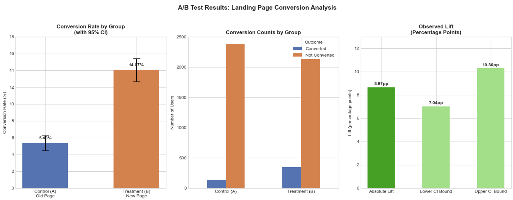
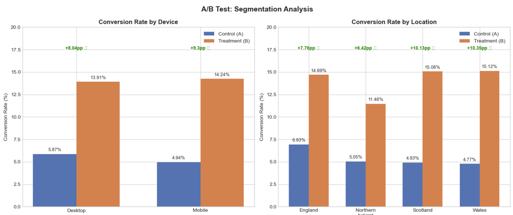
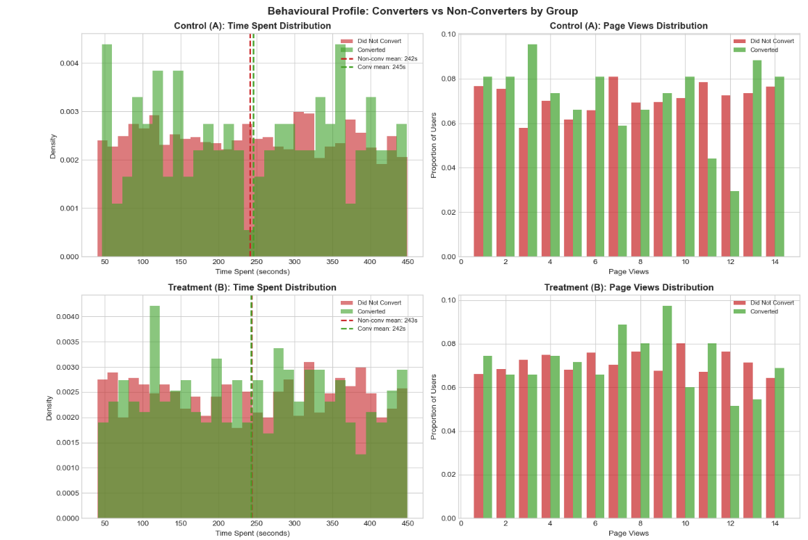
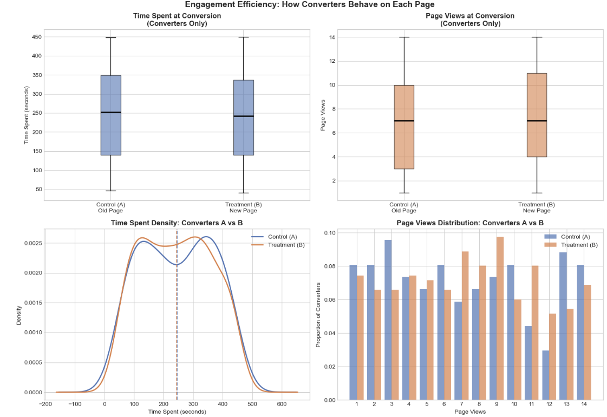
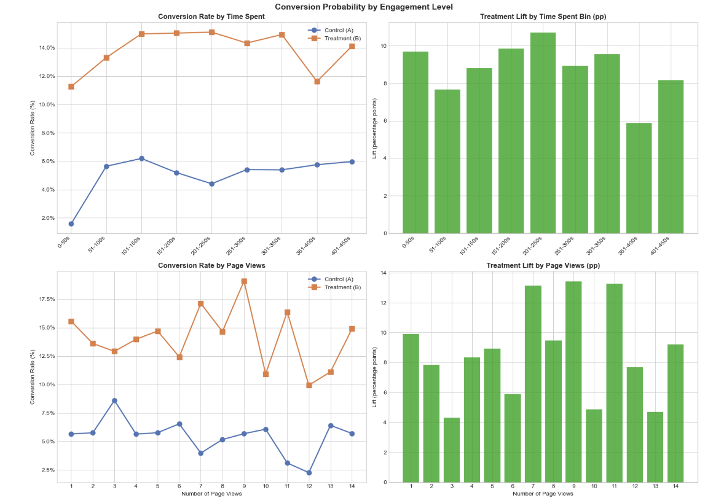
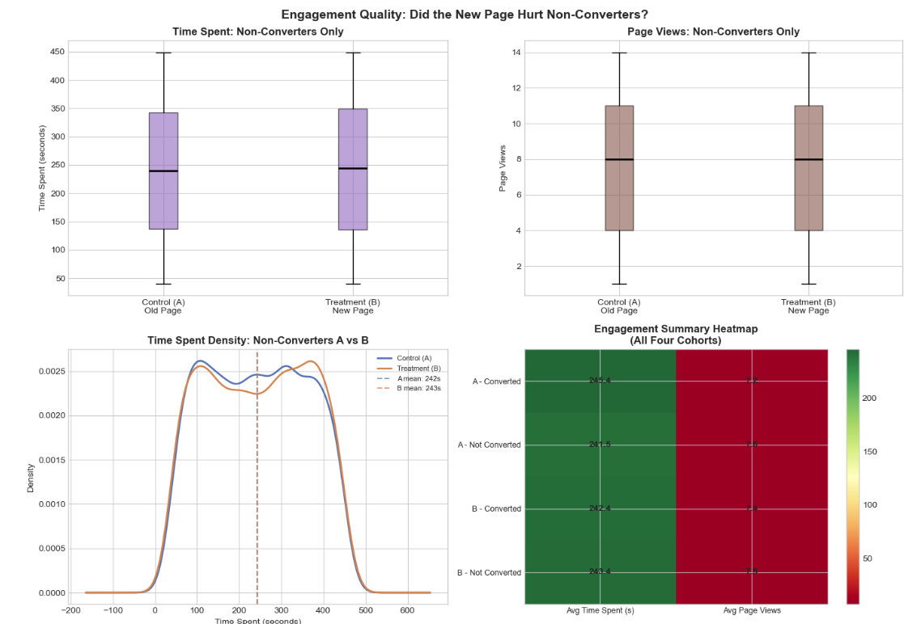

# E-Commerce Landing Page A/B Test

**An end-to-end experiment comparing two landing pages: sanity checks, power analysis, a statistical test, segmentation and a business recommendation.**

---

## Result

The new landing page lifted conversion from 5.40% to 14.07%.

| Metric | Control (A) | Treatment (B) |
|---|---|---|
| Users | 2,519 | 2,481 |
| Conversion rate | 5.40% | 14.07% |

- **Absolute lift:** +8.67 percentage points (95% CI: 7.04 to 10.30)
- **Relative lift:** +160.5%
- **Test:** two-proportion z-test, z = 10.35, p < 0.001
- **Effect size:** Cohen's h = 0.30
- **Segments:** the lift is significant in all six segments (desktop, mobile, England, Scotland, Wales and Northern Ireland)

## Business question

Does the new landing page convert more visitors than the current one, and is the result reliable enough to ship?

## Dataset

A synthetic UK retail dataset of 5,000 users and 7 columns: `user_id`, `group`, `page_views`, `time_spent`, `conversion`, `device` and `location`. The data is synthetic, so the size of the lift should not be taken as a prediction for a real store. The project demonstrates the method.

## Repository structure

~~~
ab-test-analysis.ipynb   full analysis notebook
ab_testing.csv           dataset
ab_test_*.png            charts used in this README
README.md
~~~

## Analysis

### 1. Sanity checks

Before testing, I checked the group split, looked for duplicate users, and confirmed the groups were balanced by device and by location.

### 2. Power analysis

Using alpha = 0.05, 80% power and Cohen's h as the effect size, the test needed about 175 users per group. The groups had 2,519 and 2,481 users, around 14 times the minimum, so the test was adequately powered.

### 3. Statistical test

A two-sided two-proportion z-test on conversion gave z = 10.35 and p < 0.001. The 95% confidence interval for the lift is 7.04 to 10.30 percentage points. It does not include zero.

### 4. Segmentation

I repeated the comparison by device and by region. The new page won in all six segments.

### 5. Behavioural deep-dive

Four follow-up questions checked whether the new page changed how users behave, not just whether they convert. These used Mann-Whitney U tests:

- Do converters behave differently from non-converters?
- Did the new page make users faster to convert?
- Does conversion probability change with engagement level?
- Did the new page damage the experience for non-converters?

The engagement metrics (page views and time spent) showed no significant difference between the two pages.

## Key finding

The new page lifted conversion, and engagement metrics showed no significant difference between the two pages.

## Business recommendation

1. Ship the new page.
2. Monitor revenue for four weeks after launch to confirm the lift turns into sales.
3. Run a follow-up test on the call-to-action and the offer block.

## Caveats

- The data is synthetic.
- There is no revenue data, so the effect on sales is unknown.
- The test duration is unknown, so novelty effects cannot be ruled out.
- Six segments were tested without adjusting for multiple comparisons, so segment results are best read as supporting evidence for the overall result.

## How to run

1. Clone the repository:

   ~~~
   git clone https://github.com/biancakhambatta/AB-Testing.git
   cd AB-Testing
   ~~~

2. Install the libraries:

   ~~~
   pip install pandas numpy scipy statsmodels matplotlib jupyter
   ~~~

3. Open the notebook:

   ~~~
   jupyter notebook ab-test-analysis.ipynb
   ~~~
